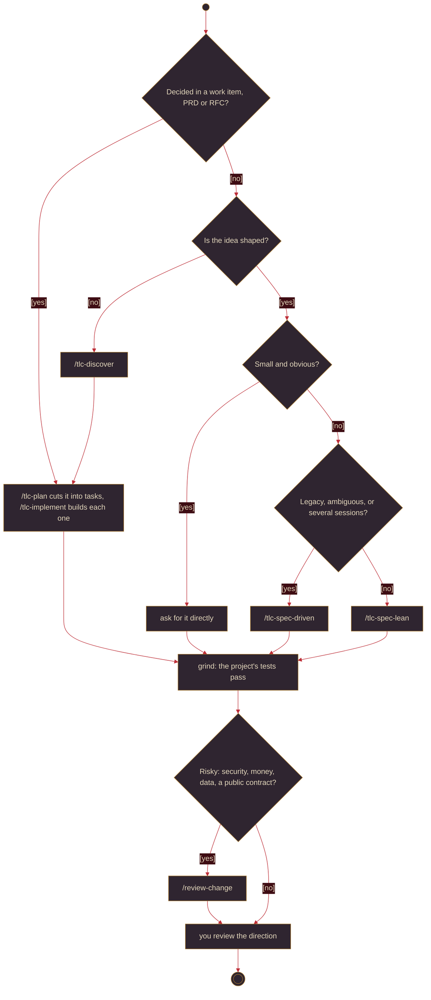
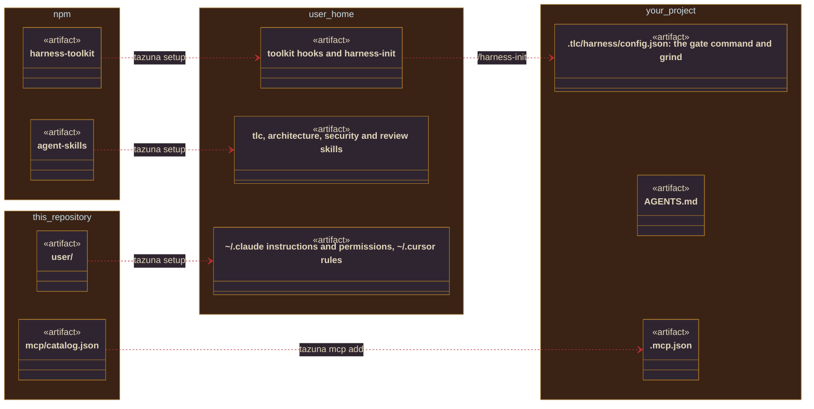
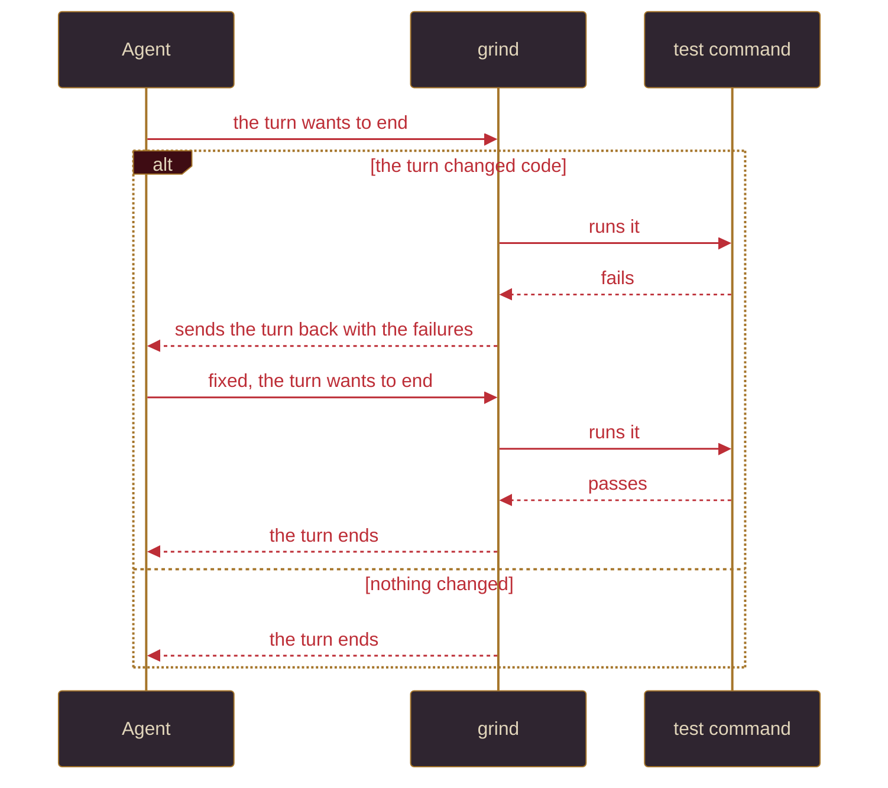
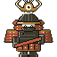

<div align="center">



<h1>Tazuna</h1>

[](CHANGELOG.md)
[](#prerequisites)
[](#prerequisites)
[](LICENSE)

*No turn ends on untested code. The seal lights only for what was proven.*

Claude Code and Cursor on Windows, set up in one command on top of the Tech Leads Club's harness-toolkit and agent skills. Tazuna sets up the machine; harness-toolkit sets up each project and runs its tests before a turn ends.

[Getting started](#getting-started) · [Usage](#usage) · [Report a problem](https://github.com/AlfredoNeeto/tazuna/issues)

</div>

<details>
<summary>Table of contents</summary>

1. [About the project](#about-the-project)
2. [Getting started](#getting-started)
3. [Usage](#usage)
4. [How it works](#how-it-works)
5. [Safety](#safety)
6. [Troubleshooting](#troubleshooting)
7. [Contributing](#contributing)
8. [License](#license)
9. [Acknowledgments](#acknowledgments)

</details>

## About the project

> *No work is finished because its author says so.*

A coding agent often ends its turn with "done" on code that nobody ran, and adding rules to the prompt does not change that. What helps is a small context, room to implement, and proof from someone who did not write the code. Tazuna sets that up for Claude Code or Cursor, whichever you use. The one step that is enforced, running the project's tests before a turn that changed code can end, is harness-toolkit's `grind`; Tazuna installs the toolkit, and `tazuna doctor` tells you when a project's gate is off or cannot start.

Tazuna (手綱) means reins, the part of a horse's harness the rider holds. Writing on agents describes *Agent = Model + Harness*, where the harness combines guides, which steer the agent before it acts (`AGENTS.md`, rules, skills, permissions), and sensors, which check the result afterwards (the toolkit's gate, the Verifier, `/review-change`). Reins do both: they steer the horse and let the rider feel it, and the horse still supplies the strength.

Tazuna itself is small. It installs and pins `harness-toolkit` and the Tech Leads Club skills, adds `/review-change`, `/ship` and its user settings, and leaves each project to `harness-toolkit` and your repository.

## Getting started

> *Before the vigil, the vessel is prepared.*

### Prerequisites

| You need | For | If it is missing |
|---|---|---|
| Windows PowerShell 5.1 | everything | it ships with Windows |
| Git | cloning and updating | `setup` stops and says so |
| Node.js 24+ | the toolkit, the skills, the MCP servers | `setup` stops and prints `winget install OpenJS.NodeJS.LTS` |
| Claude Code 2.1.296+, or Cursor | the agent; either one is enough. With Cursor, open it once before `setup` ([docs/cursor.md](docs/cursor.md)) | `setup` stops when neither is installed |
| `python3` | the validators of the `tlc-*` skills | a warning; the skills check the artifacts by reading them |

### Installation

Run this in your own terminal, outside Claude Code and Cursor:

```powershell
git clone https://github.com/AlfredoNeeto/tazuna.git "$HOME\tazuna"; & "$HOME\tazuna\bin\tazuna.cmd" setup
```

`tazuna-setup.exe` does the same with a double-click and keeps its window open until you press Enter. `scripts\build-installer.ps1` builds it and CI keeps it as the `tazuna-setup` artifact; it is not signed, so SmartScreen names an unknown publisher. `setup` adds `tazuna` to your user PATH. To use it in the same shell, run the line it prints:

```powershell
$env:Path += ";$HOME\tazuna\bin"
```

`setup` installs `harness-toolkit` 0.16.3 and runs `tlc harness install`, installs the `tlc-*`, `harness-eval`, modular-architecture, security, `the-judge`, `coding-guidelines`, `create-adr` and `create-rfc` skills from the pinned skills catalog 0.17.9 and the user MCP servers, then runs `tazuna doctor`. Running it again repairs a machine that drifted, and removes what an earlier version installed and this one no longer ships, keeping any copy you edited. Running the installer again on a machine that has Tazuna updates its clone first, so it replaces the installed version; a clone with local changes is refused, not overwritten. For Claude Code it also copies `user/` into `~/.claude` and adds the `ponytail` plugin. It replaces `~/.claude/CLAUDE.md` and, in `~/.claude/settings.json`, the keys Tazuna ships, keeps your other keys and a backup of what it replaces in `~/.claude\.harness-backup\`; those settings switch off the claude.ai connectors and sync (`disableClaudeAiConnectors`). For Cursor it puts the skills, the instructions as a rule, the toolkit hooks and the servers under `~/.cursor`, and with both installed it equips both. Run `setup` and `update` outside the agent, and call `bin\tazuna.cmd` rather than the `.ps1`, which an `AllSigned` execution policy blocks.

### Your first project

Open the project in Claude Code or Cursor and run `/harness-init`, the toolkit's own setup. Then, in your terminal, name the command that proves the project works and turn the gate on:

```powershell
cd C:\src\MyApi
tlc harness gate test-command dotnet test
tlc harness grind on
```

`/harness-init` writes the project's policy, `.tlc/harness/config.json`, and its hook shims, and adds `.claude/settings.json` and `.cursor/hooks.json` to `.gitignore` because the shims hold a path on your machine. The gate starts its command without a shell, so on Windows the command must begin with an `.exe`: `dotnet test`, `cmd /c npm test`, `powershell.exe -NoProfile -File scripts\test.ps1`. `tazuna doctor`, run inside the project, warns when it does not and says whether `grind` is on. In `AGENTS.md`, write only what the code does not show, because every line there goes into every turn.

### Upgrading from 1.x

Run the installer again, or `tazuna update`. Then, in each project 1.x set up, run `tazuna init` before `/harness-init`: it removes the 1.x gate with a backup in `.harness-backup\`. It always removes the three hooks, `VerifyCommon.psm1` and `.claude\state\`. It removes `verify.ps1` and the stack rules only while they are what 1.x wrote; an edited `verify.ps1` is kept, and its steps are printed as the command to give the gate. It takes Tazuna's entries out of `.claude/settings.json` and `.cursor/hooks.json` and leaves `AGENTS.md` alone. `-WhatIf` lists all of it first.

<p align="center"></p>

## Usage

> *Every work is weighed. None leaves the forge untested.*

### The loop

```mermaid
stateDiagram-v2
    direction LR
    [*] --> Discovery
    Discovery --> Plan
    Plan --> Checks: you approve
    Checks --> Build
    Build --> Verify
    Verify --> Build: a check fails
    state "Code review" as Review
    state "Human review" as Human
    Verify --> Review: every check passes
    Review --> Human
    Human --> [*]
    classDef optional fill:#2f2530,stroke:#a5752a,color:#e2d6bb,stroke-dasharray: 5 5
    classDef enforced fill:#7f1721,stroke:#d9a948,color:#e2d6bb,stroke-width: 3px
    classDef rite fill:#2f2530,stroke:#a5752a,color:#e2d6bb
    class Discovery,Plan,Checks,Review optional
    class Verify enforced
    class Build,Human rite
```



`Verify` is enforced once `grind` is on: when a turn that changed code ends, harness-toolkit runs the project's test command and sends a failure back to the agent. The dashed steps depend on the workflow you choose.

### Choosing a workflow



| Size of the change | What to use |
|---|---|
| An idea not shaped yet | `/tlc-discover` |
| A feature | `/tlc-spec-lean` |
| Legacy code, ambiguous requirements, several sessions | `/tlc-spec-driven` |
| Work already decided in a work item, PRD or RFC | `/tlc-plan` to cut it into tasks, `/tlc-implement` to build each one |
| Risky: security, money, data, a public contract | `/review-change`, even when the change is small |
| A reported bug | ask for a failing test first, then the fix at the root cause |
| A finished change to hand over | `/ship`: verify, read the diff, write the commit and the PR text; it never pushes |

With `/tlc-spec-lean I want X`, the agent reads the code, asks you only about decisions that are yours, writes `.specs/features/<feature>/plan.md` and stops until you approve it. Each criterion becomes a check with the test that settles it. The agent builds, and a fresh Verifier that never saw the implementation proves every check. A changed screen is opened with Playwright before it is done.

### Adding an MCP server

`tazuna mcp list` shows the catalog and `tazuna mcp add <name>` adds a server to the project you are in:

| Name | For |
|---|---|
| `azure-devops` | pull requests, work items, wiki and search on an on-premises Azure DevOps Server; asks for the project URL and a token, checks them, and keeps them for that project only |
| `serena` | symbol navigation: callers, implementations, declarations; needs `uvx` |
| `drawio` | editing diagrams in draw.io |
| `plantuml` | rendering PlantUML; the diagram text goes to `PLANTUML_SERVER_URL`, the public `plantuml.com` if unset |
| `mermaid` | rendering Mermaid locally |

The command merges the entry into the project's `.mcp.json` and enables it, with credentials only as `${VARIABLE}` placeholders; restart Claude Code and approve the server. `.mcp.json` belongs to Claude Code, so in Cursor add the server to `.cursor/mcp.json` by hand. See [docs/mcp.md](docs/mcp.md).

### Commands

| Command | What it does |
|---|---|
| `tazuna setup` | installs or repairs the machine, then runs `doctor` |
| `tazuna init` | moves a project 1.x set up off the old gate, then points to `/harness-init` |
| `tazuna mcp` | `mcp list` shows the catalog; `mcp add <name>` adds a server to the project |
| `tazuna doctor` | checks the toolchain, the toolkit hooks, the skills and drift from this repository; inside a project, its gate |
| `tazuna update` | fast-forwards this repository and runs `setup` again |
| `tazuna test` | runs this repository's self-test |
| `tazuna help <command>` | shows a command's options and examples; `tazuna <command> --help` does the same |
| `tazuna version` | shows the installed version; `--version` and `-v` work too |

`setup`, `init`, `mcp` and `update` accept `-WhatIf`, and a mistyped name gets the closest suggestion. `TAZUNA_PLAIN=1` forces ASCII output and `NO_COLOR` removes colour.

<p align="center"></p>

## How it works

> *The seal lights only for what was proven.*



What holds for every session lives in your user directory, `~/.claude` or `~/.cursor`; what belongs to the team lives in the project, in version control.



`grind` is harness-toolkit's: it runs the project's test command when a turn that changed code ends, keeps its result per session, retries up to its configured limit and says so when the same failure repeats. Tazuna installs the toolkit and its hooks, and `tazuna doctor` checks from inside a project that the gate is on and can start its command.

## Safety

> *What is sacred is guarded, not trusted.*

| Protection | Enforced by |
|---|---|
| No turn ends on untested code | harness-toolkit's `grind`, once a project has a test command and it is on |
| Nothing is published or destroyed without you: `git push`, `reset --hard`, `clean`, `gh pr create`, `terraform apply` are denied, `commit` asks | permissions in `~/.claude/settings.json`. They match the command's start, so a push written behind a git global option, such as `git -C . push`, is not caught by them, and Cursor has no permission rules at all: there, harness-toolkit only stops `push --force` |
| Secrets stay out of the context: `.env`, `*.pem` and `~/.ssh` are unreadable, secret-looking output is masked | Claude Code permissions and `harness-toolkit` |
| Nothing is destroyed outside the repository, and `push --force` is denied | the `harness-toolkit` floor, which in 0.16.3 sees only Bash tool commands; for PowerShell the `deny` rules hold |
| No feature is done without independent proof | the Verifier and `validate_verification.py` |

## Troubleshooting

> *Confess the symptom; the remedy follows.*

| Symptom | What to do |
|---|---|
| `tazuna` is not recognised | open a new shell, or run `& "$HOME\tazuna\bin\tazuna.cmd" setup` |
| `doctor`: `no tlc-exec hook` or `skill ... is missing` | run `tazuna setup` in your terminal |
| The project's tests never run when a turn ends | run `tazuna doctor` in the project: `grind` is off, there is no test command, or the command starts with a `.cmd` or `.ps1` the gate cannot start; wrap it in `cmd /c` |
| `doctor`: the Tazuna 1.x gate is still here | run `tazuna init` in that project |
| The toolkit denied something | `tlc harness why` shows the latest decisions and their rules |
| `doctor`: `installed but not in the repository` | a skill or agent you added yourself; it stays active, and `setup` never removes it |
| `.claude/settings.json` is now in `.gitignore` | `/harness-init` puts it there because its hook shims hold a path on your machine |
| Everything looks wrong in Claude Code | `claude --safe-mode` starts it without any customisation |

<p align="center"></p>

## Contributing

> *The order welcomes every pilgrim who brings proof.*

Issues and pull requests are welcome. The rules are in [AGENTS.md](AGENTS.md): after any change `tazuna test` has to print `HARNESS SELF-TEST PASSED`, and the target is Windows PowerShell 5.1. CI runs the same self-test on `windows-latest`. Changes are listed in [CHANGELOG.md](CHANGELOG.md).

## License

> *Each relic keeps the covenant it was given.*

Tazuna's own code is released under the MIT License, see [LICENSE](LICENSE). What it installs keeps its own licence:

| Piece | Licence |
|---|---|
| `harness-toolkit` | Elastic License 2.0: free to use and modify, not to offer as a hosted service; not OSI open source |
| `agent-skills` (the Tech Leads Club skills `setup` installs) | CC-BY-4.0, with attribution to the Tech Leads Club |
| `humanizer` skill by Siqi Chen | MIT, in [user/skills/humanizer/LICENSE](user/skills/humanizer/LICENSE) |
| `ponytail` plugin by [DietrichGebert](https://github.com/DietrichGebert/ponytail) | its own licence, in that repository; installed from its marketplace, not copied here |

## Acknowledgments

> *Honour to those who forged the reins.*

- The workflow, the skills and the toolkit come from the [Tech Leads Club](https://github.com/tech-leads-club).
- The ideas behind the loop come from Waldemar Neto's video, [https://www.youtube.com/watch?v=yKLedmyUDMA](https://www.youtube.com/watch?v=yKLedmyUDMA).
- `humanizer` 3.0.0 comes from [akitaonrails/my-skills](https://github.com/akitaonrails/my-skills/tree/master/humanizer).
- Frenatus is the original mascot of Tazuna, drawn for this repository in tenebrist pixel art ([docs/mascot.md](docs/mascot.md)); the layout follows [Best-README-Template](https://github.com/othneildrew/Best-README-Template).

<p align="center"><br><br><sub>Plan, Checks, Build, Verify, Review. The model reads everything else from your repository.</sub></p>
